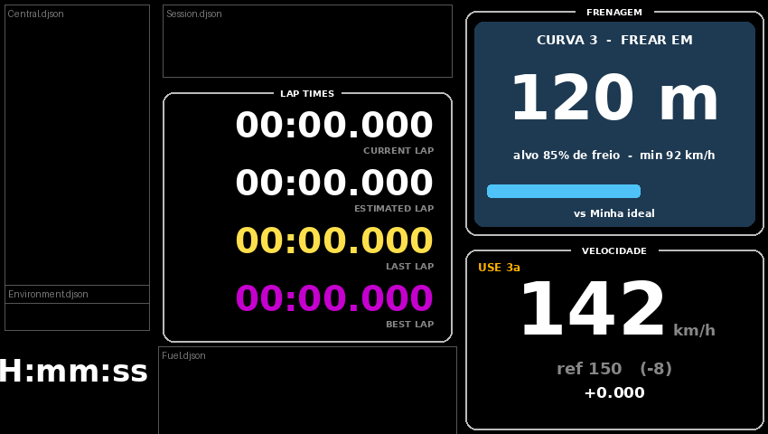

# AC Coach

**Real-time braking & speed coach for Assetto Corsa** — with an optional SimHub dashboard.
**Coach de frenagem e velocidade em tempo real para Assetto Corsa** — com dashboard opcional no SimHub.

[English](#english) · [Português](#português)



---

## English

AC Coach is a native Assetto Corsa Python app. It records your laps, builds a reference lap and, while you drive, tells you where to brake, how hard, whether you are below the reference speed and which gear the reference uses at that point of the track.

### Two versions

| | `standalone/` | `simhub/` |
|---|---|---|
| Where it shows | Inside the game (two app windows) | SimHub dashboard **AC Coach Lovely** (phone, tablet, second screen, wheel display) |
| In-game window | Full coach panel | Only the reference selector |
| Needs SimHub | No | Yes, plus Lovely Dashboard + Lovely Plugin |
| Keyboard shortcuts | Optional (see below) | Yes |

The analysis engine (`coach_core.py`) is the same file in both.

### Features

- **Braking panel**: next corner, metres to the brake point, target brake pressure and minimum apex speed. Turns amber at 30 m ("PREPARE"), red at the brake point ("FREIE!" = brake!). While braking it compares your pressure with the reference: *ALIVIE* (ease off), *MAIS FREIO* (more brake), *SOLTE O FREIO* (release), *no ponto* (on target).
- **Lock-up warning**: flashes purple when a wheel turns 12% slower than the car.
- **Speed vs reference**: the window/dash turns red when you are more than `SPEED_RED` (3 km/h) below the reference at the same point of the track.
- **Gear indicator**: shows the gear the reference uses *here*, with an amber ring when you are in a different one.
- **Live delta** against the reference.
- **Tip after every corner** comparing brake point, pressure, release and minimum speed.
- **References**: *My ideal* (best mini-sectors combined), *My best*, *AI (recorded)* — fastest lap of an AI car of the same model — and 5 simulated levels (*Beginner → Professional*) computed from your car's grip, braking and acceleration limits on that track.
- **Off-track filter**: a lap that left the track (geometric test, not only the game's "tyres off" flag) never becomes a reference.
- Choice of reference is saved per car/track.

### Install — standalone (no SimHub)

1. Copy `standalone/ac_coach` to `<Assetto Corsa>\apps\python\`
   or run in PowerShell: `.\install.ps1 -Version standalone -AcPath "<Assetto Corsa folder>"`
2. Enable it: Content Manager → Settings → Assetto Corsa → Python apps → **AC Coach**
   (original launcher: Options → General → UI Modules).
3. In game, open **AC Coach** and **AC Coach - Dica** from the app bar on the right.

### Install — SimHub version

1. Install **SimHub**, then the **Lovely Dashboard** and the **Lovely Plugin** from the official source: <https://github.com/Lovely-Sim-Racing/lovely-dashboard>. The AC Coach dash reuses Lovely widgets (Central, Environment, Session, Fuel), fonts and scripts, which are **not** included in this repo.
2. Run in PowerShell (as administrator if SimHub is under *Program Files*):
   ```powershell
   .\install.ps1 -Version simhub -AcPath "D:\Steam\steamapps\common\assettocorsa" -SimHubPath "C:\Program Files (x86)\SimHub"
   ```
   The script copies the app, copies the dash, pulls the Lovely files from your own `DashTemplates\Lovely Dashboard` and rewrites the `live.txt` path inside the dash.
3. Enable **AC Coach** in Content Manager, restart SimHub and open **AC Coach Lovely**.

**Manual install:** copy `simhub/ac_coach` to `apps\python\`, copy `simhub/dash/AC Coach Lovely` to `SimHub\DashTemplates\`, copy `Central/Environment/Fuel/Session.djson*`, `_SHFonts` and `JavascriptExtensions` from `Lovely Dashboard` into it, then in Dash Studio edit the dashboard variable **acCoach** and change the path in `readtextfile(...)` to your `ac_coach\live.txt`.

#### How the SimHub link works

The app writes a small `live.txt` (`key=value` lines, ~20×/s) in its own folder. The dash reads it with `readtextfile()` into the `acCoach` variable and `JavascriptExtensions/AC-Coach_live.js` exposes `acc(key)`, `acc_num(key)`, `acc_on()` (file updated in the last 3 s) and `acc_low()`. No plugin or shared memory needed.

### Keyboard shortcuts

`Alt+1` My ideal · `Alt+2` My best · `Alt+3` AI · `Alt+4…8` levels · `Alt+0` next reference (top row or numpad).

AC's embedded Python has no `ctypes`. The app loads `_ctypes.pyd` from `apps\python\SimHub\stdlib64` (installed by SimHub's own AC app) or from `ac_coach\stdlib64`. Without it, use the **Ref** button in game.

### Configuration

All in `coach_core.py`: `SPEED_RED`, `LOCK_RATIO`, `OFFTRACK_M`, `MAX_SAVED_LAPS`, `LEVELS`, `LIMIT_MARGIN`.
`referencias.json` holds optional real lap-time targets per car/track to calibrate the levels. See `LEIA-ME.txt` (Portuguese) for the full details.

### Troubleshooting

- `erro:` on the **Ref** button → details in `Documents\Assetto Corsa\logs\py_log.txt` (lines `[AC Coach]`).
- SimHub dash frozen/blank → check the `live.txt` path in the `acCoach` variable, and that the file's timestamp is changing while you drive.
- Laps are stored in `ac_coach\data\<car>__<track>__<length>.json`.

### Notes

- Tested on Assetto Corsa (Python 3.3 embedded), SimHub 9.12.4. The standalone UI was rebuilt from the SimHub version and has not yet been tested in game — please open an issue if something looks off.
- UI texts are in Portuguese.
- Not affiliated with Kunos Simulazioni, SimHub or Lovely Sim Racing.

---

## Português

O AC Coach é um app Python nativo do Assetto Corsa. Ele grava suas voltas, monta uma volta de referência e, enquanto você pilota, mostra onde frear, com quanta força, se você está abaixo da velocidade da referência e qual marcha a referência usa naquele ponto da pista.

### Duas versões

| | `standalone/` | `simhub/` |
|---|---|---|
| Onde aparece | Dentro do jogo (duas janelas) | Dashboard **AC Coach Lovely** no SimHub (celular, tablet, segunda tela, display do volante) |
| Janela no jogo | Painel completo | Só o seletor de referência |
| Precisa de SimHub | Não | Sim, mais Lovely Dashboard + Lovely Plugin |
| Atalhos de teclado | Opcionais (ver abaixo) | Sim |

O motor de análise (`coach_core.py`) é o mesmo arquivo nas duas.

### Funções

- **Painel de frenagem**: próxima curva, metros até o ponto de freada, pressão de freio alvo e velocidade mínima no ápice. Fica âmbar a 30 m ("PREPARE") e vermelho no ponto ("FREIE!"). Durante a freada compara sua pressão com a da referência: *ALIVIE*, *MAIS FREIO*, *SOLTE O FREIO*, *no ponto*.
- **Aviso de travamento**: pisca roxo quando uma roda gira 12% mais devagar que o carro.
- **Velocidade x referência**: a janela/dash fica vermelha quando você está mais de `SPEED_RED` (3 km/h) abaixo da referência no mesmo ponto da pista.
- **Indicador de marcha**: mostra a marcha que a referência usa *aqui*, com anel âmbar quando você está em outra.
- **Delta ao vivo** contra a referência.
- **Dica depois de cada curva** comparando ponto de freada, pressão, soltura e velocidade mínima.
- **Referências**: *Minha ideal* (melhores minissetores juntos), *Minha melhor*, *IA (gravada)* — a volta mais rápida de um carro da IA do mesmo modelo — e 5 níveis simulados (*Iniciante → Profissional*), calculados pelos limites de aderência, frenagem e aceleração do seu carro naquela pista.
- **Filtro de saída de pista**: volta que saiu do traçado (teste geométrico, não só o "pneus fora" do jogo) nunca vira referência.
- A referência escolhida fica salva por carro/pista.

### Instalar — standalone (sem SimHub)

1. Copie `standalone/ac_coach` para `<Assetto Corsa>\apps\python\`
   ou rode no PowerShell: `.\install.ps1 -Version standalone -AcPath "<pasta do Assetto Corsa>"`
2. Ative: Content Manager → Configurações → Assetto Corsa → Python apps → **AC Coach**
   (launcher original: Options → General → UI Modules).
3. No jogo, abra **AC Coach** e **AC Coach - Dica** na barra de apps à direita.

### Instalar — versão SimHub

1. Instale o **SimHub**, depois o **Lovely Dashboard** e o **Lovely Plugin** pela fonte oficial: <https://github.com/Lovely-Sim-Racing/lovely-dashboard>. O dash do AC Coach reaproveita widgets do Lovely (Central, Environment, Session, Fuel), fontes e scripts, que **não** vêm neste repositório.
2. Rode no PowerShell (como administrador se o SimHub estiver em *Program Files*):
   ```powershell
   .\install.ps1 -Version simhub -AcPath "D:\Steam\steamapps\common\assettocorsa" -SimHubPath "C:\Program Files (x86)\SimHub"
   ```
   O script copia o app, copia o dash, puxa os arquivos do Lovely da sua própria pasta `DashTemplates\Lovely Dashboard` e reescreve o caminho do `live.txt` dentro do dash.
3. Ative o **AC Coach** no Content Manager, reinicie o SimHub e abra o **AC Coach Lovely**.

**Instalação manual:** copie `simhub/ac_coach` para `apps\python\`, copie `simhub/dash/AC Coach Lovely` para `SimHub\DashTemplates\`, copie para dentro dele `Central/Environment/Fuel/Session.djson*`, `_SHFonts` e `JavascriptExtensions` do `Lovely Dashboard`, e no Dash Studio edite a variável do dashboard **acCoach** trocando o caminho em `readtextfile(...)` pelo do seu `ac_coach\live.txt`.

#### Como o SimHub recebe os dados

O app grava um `live.txt` pequeno (linhas `chave=valor`, ~20×/s) na própria pasta. O dash lê com `readtextfile()` na variável `acCoach`, e o `JavascriptExtensions/AC-Coach_live.js` expõe `acc(chave)`, `acc_num(chave)`, `acc_on()` (arquivo atualizado nos últimos 3 s) e `acc_low()`. Não precisa de plugin nem memória compartilhada.

### Atalhos de teclado

`Alt+1` Minha ideal · `Alt+2` Minha melhor · `Alt+3` IA · `Alt+4…8` níveis · `Alt+0` próxima referência (números de cima ou teclado numérico).

O Python embutido no AC não tem `ctypes`. O app carrega o `_ctypes.pyd` de `apps\python\SimHub\stdlib64` (instalado pelo app do SimHub para o AC) ou de `ac_coach\stdlib64`. Sem ele, use o botão **Ref** no jogo.

### Configuração

Tudo em `coach_core.py`: `SPEED_RED`, `LOCK_RATIO`, `OFFTRACK_M`, `MAX_SAVED_LAPS`, `LEVELS`, `LIMIT_MARGIN`.
O `referencias.json` guarda tempos-alvo reais opcionais por carro/pista para calibrar os níveis. Detalhes completos no `LEIA-ME.txt` de cada versão.

### Problemas

- `erro:` no botão **Ref** → detalhe em `Documentos\Assetto Corsa\logs\py_log.txt` (linhas `[AC Coach]`).
- Dash do SimHub parado/vazio → confira o caminho do `live.txt` na variável `acCoach` e se a data do arquivo muda enquanto você pilota.
- As voltas ficam em `ac_coach\data\<carro>__<pista>__<comprimento>.json`.

### Observações

- Testado no Assetto Corsa (Python 3.3 embutido) e SimHub 9.12.4. A interface standalone foi refeita a partir da versão SimHub e ainda não foi testada no jogo — abra uma issue se algo estiver estranho.
- Os textos da interface estão em português.
- Sem vínculo com Kunos Simulazioni, SimHub ou Lovely Sim Racing.

---

## Repository layout / Estrutura

```
ac-coach/
├── standalone/ac_coach/        in-game app, no SimHub / app no jogo, sem SimHub
├── simhub/
│   ├── ac_coach/               app that feeds the dash / app que alimenta o dash
│   └── dash/AC Coach Lovely/   SimHub dashboard (+ AC-Coach_live.js)
├── docs/                       images / imagens
├── install.ps1                 installer / instalador
└── LICENSE
```

## License / Licença

MIT — see [LICENSE](LICENSE). Lovely Dashboard files are © Lovely Sim Racing and are not part of this repository.
